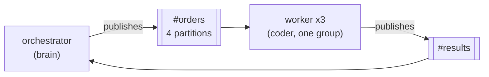
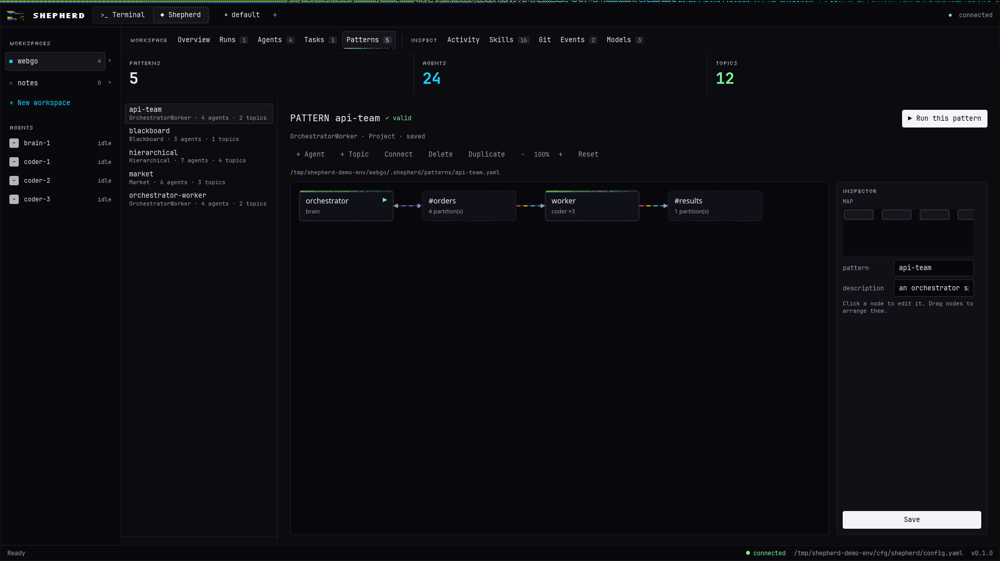
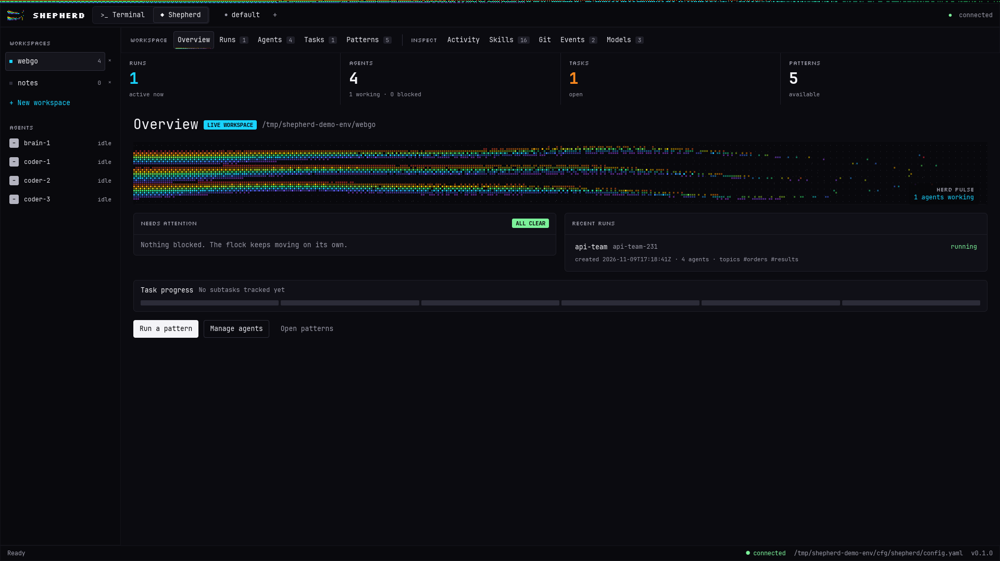
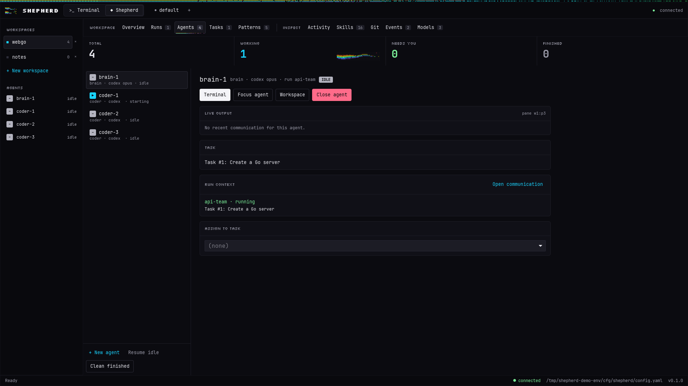
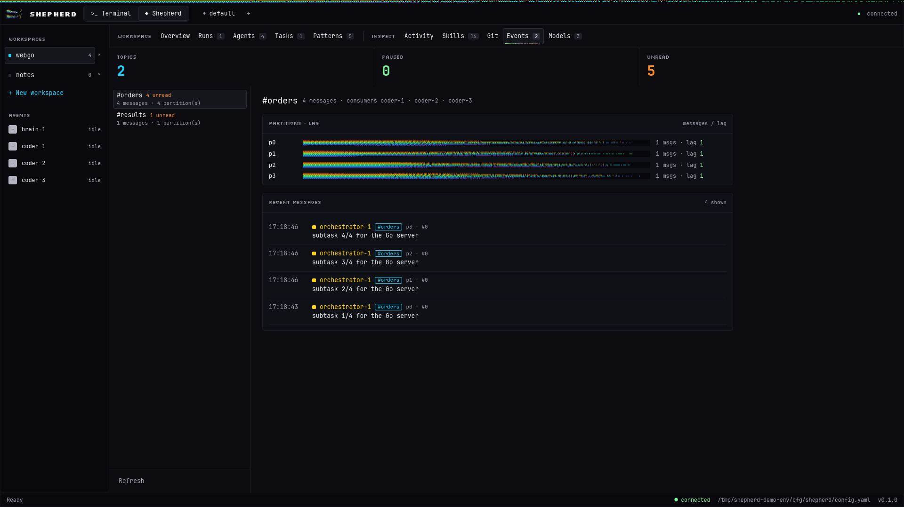
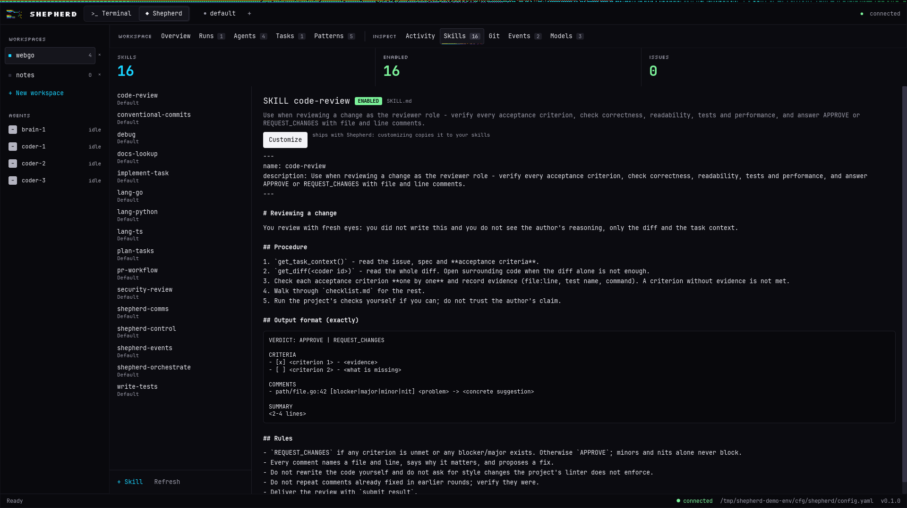
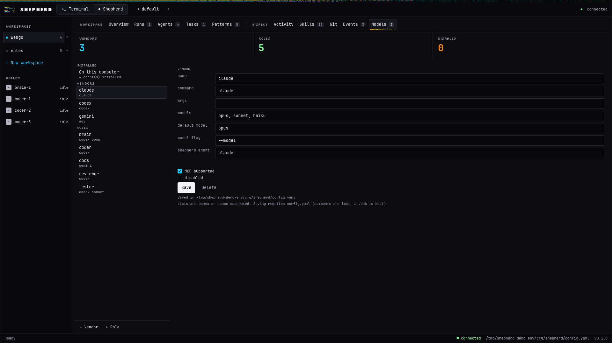

<h1 align="center">shepherd</h1>

<p align="center"><b>the orchestrator for your coding agents.</b><br>
build teams of claude, codex and gemini agents, give them roles, and let them work in parallel, each in its own git worktree.</p>

<p align="center">
  <a href="https://shepherdr.rivaldito.com">website</a> ·
  <a href="#patterns-your-agent-teams">patterns</a> ·
  <a href="#roles-who-does-what">roles</a> ·
  <a href="#try-it-from-scratch">try it from scratch</a> ·
  <a href="#documentation">docs</a> ·
  <a href="#built-on-herdr">built on herdr</a> ·
  <a href="#license">license</a>
</p>

<p align="center">
  <a href="LICENSE"></a>
  <a href="https://github.com/herdrdev/herdr"></a>
  <a href="https://github.com/Rivaldito/shepherd/releases"></a>
  
</p>

<p align="center">
  <a href="https://github.com/Rivaldito/shepherd/releases/download/v0.1.0-beta/shepherd-demo.mp4">
    
  </a>
</p>

<p align="center"><sub>a 35 second tour of the native app. <a href="https://github.com/Rivaldito/shepherd/releases/download/v0.1.0-beta/shepherd-demo.mp4">watch it as mp4</a>.</sub></p>

> **a fork of [herdr](https://github.com/herdrdev/herdr)** (apache-2.0), forked from herdr 0.9.5 at upstream commit `ee5bfb5`. the herdr history is preserved below the shepherd commit; shepherd is not affiliated with the herdr project.

shepherd adds multi-agent orchestration on top of herdr's terminal runtime. you keep the native terminal of every agent; shepherd decides who works on what, in which worktree, and how they talk to each other. not sure it is for you? read [why shepherd](docs/shepherd/why-shepherd.md), which also says when it is not. more at **[shepherdr.rivaldito.com](https://shepherdr.rivaldito.com)**.

---

## what you get

| | |
|---|---|
| 🧩 **patterns** | agent teams as yaml. four ready-made topologies, and you can create your own. |
| 🎭 **roles** | `brain`, `coder`, `reviewer`, `docs`, `tester` out of the box, and your own roles with their own vendor, model and skills. |
| 🌿 **a worktree per agent** | each coder gets its own branch, so agents never step on each other. you merge with plain git; shepherd never merges or pushes. |
| 📡 **an event bus** | topics, partitions, consumer groups and replay. publishing wakes idle agents. |
| ✅ **tasks and gates** | specs and acceptance criteria, plan approval, and publishing only with your explicit ok. |
| 🛟 **snapshots** | automatic safety copies of every worktree, with diff and safe restore. |
| 🖥️ **terminal, native app and cli** | a shepherd section in the terminal (`ctrl+b a`), a desktop app, and a `--json` cli, all on the same server. |
| 🦀 **one rust binary** | no electron; runs in whatever terminal you already use. |

---

## patterns: your agent teams

a **pattern** is a team described in a yaml file: which agents, which roles, which topics they use to talk, and who starts. **four patterns ship built in**, so you can run a team on day one, and you can copy any of them or write a new one from scratch.

| pattern | shape | good for |
|---|---|---|
| `orchestrator-worker` | one orchestrator splits the work, a pool of workers does it | parallel features, batch work |
| `hierarchical` | director → managers → specialists | big objectives that split into epics and tasks |
| `blackboard` | agents share one board of hypotheses and findings | exploratory problems |
| `market` | requesters ask, solvers bid, a market-maker decides | competing several approaches |



**run a built-in pattern, or make your own in three commands:**

```bash
shepherd pattern list                                       # the four built-ins, plus your own
shepherd pattern new api-team --from orchestrator-worker    # copy a template into .shepherd/patterns/
shepherd pattern validate api-team                          # pattern is valid
shepherd pattern run api-team --task "Add GET /health and GET /version, with tests"
```

a pattern is just this:

```yaml
name: db-team
kind: orchestrator-worker
description: a planner and two migration specialists
topics:
- {name: orders, partitions: 2}
- {name: results, partitions: 1}
agents:
- id: planner
  role: brain
  prompt: Split the change into independent migrations and publish them to orders.
  publishes: [orders]
  consumes: [results]
  start: true
- id: specialist
  role: migrator          # your own role, see below
  count: 2                # two instances sharing the work
  group: migrators
  prompt: Take an order, write the migration, test it and publish the result.
  publishes: [results]
  consumes: [orders]
```

- **validation catches mistakes before agents start**: unknown roles, topics nobody reads, a market with one solver, and more.
- **edit it your way**: as yaml (`shepherd pattern edit`), in the terminal section, or in the native app's graph editor.
- **mix vendors per agent**: a cheap model for workers, a strong one for the orchestrator.
- **patterns live in your repo** (`.shepherd/patterns/`), so the team is versioned with the code. a user-wide copy goes in `~/.config/shepherd/patterns/`.

<p align="center">
  
</p>

the full reference, with every field and the rules of each topology, is in [docs/shepherd/patterns.md](docs/shepherd/patterns.md).

---

## roles: who does what

a **role** is a job description: which vendor and model do it by default, whether it gets its own worktree, whether it may start other agents, and which skills it receives.

| role | default vendor | does | own worktree |
|---|---|---|---|
| `brain` | claude / opus | plans, splits work, aggregates | no |
| `coder` | codex (falls back to gemini, claude) | implements | yes |
| `reviewer` | gemini, always a different vendor than the coder | reviews code and security | no |
| `docs` | gemini | documentation and docs questions | no |
| `tester` | claude / sonnet | tests and debugging | no |

**create your own role** in `.shepherd/config.yaml` (for one project) or `~/.config/shepherd/config.yaml` (for all of them). write only what changes:

```yaml
roles:
  migrator:
    vendor: claude
    model: sonnet
    worktree: true
    skills: [lang-go, debug]
    prompt: You write and review database migrations. Never drop a column without a backfill.
```

```
$ shepherd roles list
brain      claude/opus
coder      codex/default
docs       gemini/default
migrator   claude/sonnet        <- yours
reviewer   gemini/default
tester     claude/sonnet

$ shepherd config validate
configuration is valid
```

then use it anywhere: `shepherd spawn migrator "Add an index to users.email"`, or `role: migrator` in a pattern, as in the example above. you can also change a built-in (`coder` on claude instead of codex) or override the vendor and model for a single agent with `--vendor` and `--model`.

- **skills** are instructions installed into the agent for its role: code review, conventional commits, language conventions, or your own `SKILL.md`. assign them per role or to every agent.
- **vendors**: claude, codex and gemini (`agy`) are built in; `shepherd vendors list` shows which are installed, and you can describe another one in the config.
- **in the native app**, the models view lists the agents and models installed on your machine and lets you pick them for each role from a list.

more in [docs/shepherd/agents-roles-skills.md](docs/shepherd/agents-roles-skills.md).

---

## a look

<p align="center">
  
</p>

<table>
  <tr>
    <td></td>
    <td></td>
  </tr>
  <tr>
    <td></td>
    <td></td>
  </tr>
</table>

the native app is a desktop window over the same server as the terminal; `ctrl+shift+s` switches between the terminal and the shepherd panel. every view is in [docs/shepherd/native-app.md](docs/shepherd/native-app.md#screenshots).

---

## try it from scratch

a complete walk from an empty machine to a team of agents. it takes about ten minutes plus the first build.

**1. get the tools.** you need git, Rust 1.96.1+, Zig 0.16.0 (to build the vendored terminal library) and at least one agent cli (`claude`, `codex` or `agy`). check with `rustc --version`, `zig version` and `git --version`. if zig is not on your `PATH`, run `export ZIG=/path/to/zig`.

**2. build it.** shepherd is in beta and ships no binaries yet.

```bash
git clone https://github.com/Rivaldito/shepherd.git
cd shepherd
./cargo-fork.sh build --release                # or: cargo build --release
export PATH="$PWD/target/release:$PATH"        # so you can just type `shepherd`
```

**3. turn the orchestrator on.**

```bash
mkdir -p ~/.config/shepherd
printf '[shepherd]\nenabled = true\n' > ~/.config/shepherd/config.toml
shepherd config check                          # prints: config: ok
```

**4. make a repository to play in.** shepherd works on git repositories with at least one commit.

```bash
mkdir ~/shepherd-playground && cd ~/shepherd-playground
git init -q && git commit -q --allow-empty -m "init"
```

**5. look at what you have.**

```bash
shepherd roles list        # brain, coder, docs, reviewer, tester and their default vendors
shepherd vendors list      # which agent clis were found on your PATH
shepherd pattern list      # the four built-in team templates
```

**6. start shepherd and run one agent.** in one terminal run `shepherd`, then press `ctrl+b a` to open the shepherd section (`ctrl+b q` detaches, `shepherd` reattaches). in a second terminal, in the same folder:

```bash
shepherd spawn coder "Create hello.txt containing 'hi' and commit it." --vendor claude --model haiku
shepherd agents            # watch it go from starting to working to idle
shepherd attach coder-1    # open its terminal; answer a trust prompt if it asks
```

the agent works in its own git worktree on a branch named `shep/<n>-...`. when it finishes, merge it yourself with `git merge`; shepherd never does.

**7. run a team.** use a built-in pattern as it is, or copy one first:

```bash
shepherd pattern new api-team --from orchestrator-worker
shepherd pattern validate api-team
shepherd pattern run api-team --task "Create a.txt containing A and b.txt containing B, one worker each. Commit."
shepherd pattern runs      # state of the run
shepherd topic tail results
```

**8. make it yours.** add a role to `.shepherd/config.yaml`, point a pattern at it, and validate (see [roles](#roles-who-does-what) and [patterns](#patterns-your-agent-teams) above).

**9. optional: the native app.**

```bash
(cd native && cargo build --release -p shepherd-native)
native/dev/demo.sh         # opens the window against a throwaway server with sample data
```

to connect it to your own server instead, see [docs/shepherd/native-app.md](docs/shepherd/native-app.md). to explore without touching your own configuration at all, use `scripts/shepherd-iso.sh start` for an isolated session. every step in detail: [docs/shepherd/getting-started.md](docs/shepherd/getting-started.md).

---

## documentation

| guide | what it covers |
|---|---|
| [why shepherd](docs/shepherd/why-shepherd.md) | what shepherd adds on top of herdr and when it helps |
| [getting started](docs/shepherd/getting-started.md) | build, enable, first agent, first team, where files live, limits |
| [agents, roles and skills](docs/shepherd/agents-roles-skills.md) | agent lifecycle, roles, vendors, writing and assigning skills, mcp tools, snapshots |
| [patterns](docs/shepherd/patterns.md) | the four team topologies, the yaml format, validation, run states, a full example |
| [topics and events](docs/shepherd/topics-and-events.md) | the event bus: topics, partitions, consumer groups, replay |
| [native app](docs/shepherd/native-app.md) | the desktop window, its ten views and how to connect it |

## contributing

contributions are welcome: bug reports, ideas, docs, patterns, roles and code. start with [CONTRIBUTING.md](CONTRIBUTING.md) and the [good first issues](https://github.com/Rivaldito/shepherd/issues?q=is%3Aissue+is%3Aopen+label%3A%22good+first+issue%22); ask questions and share ideas in [discussions](https://github.com/Rivaldito/shepherd/discussions).

## keeping up with herdr

this fork follows herdr with a repeatable routine, described in [docs/UPSTREAM-SYNC.md](docs/UPSTREAM-SYNC.md).

some files in the repository root belong to herdr and are kept so merging upstream stays simple: `CHANGELOG.md` (herdr's release history), `README.zh-CN.md` and `SPONSORS.md`. shepherd's own changelog is the notes of each [release](https://github.com/Rivaldito/shepherd/releases).

## built on herdr

shepherd would not exist without [herdr](https://github.com/herdrdev/herdr) ([herdr.dev](https://herdr.dev)), created by the herdr contributors and licensed under the Apache License 2.0. the terminal multiplexer, pty management, session persistence, agent detection, client/server protocol, socket api and plugin system in this repository are their work. shepherd is based on herdr 0.9.5, keeps its history, and merges upstream changes regularly. thank you to everyone who builds herdr 🐑

what differs from herdr:

- **focus** — herdr manages agent panes; shepherd adds coordination: roles, worktrees, patterns, bus, tasks and snapshots.
- **separate config and state** — `~/.config/shepherd`, with a read-only fallback to herdr's `config.toml`.
- **no upstream auto-update** — update checks against herdr's release channels are disabled so they never replace the shepherd binary.
- **human gates** — changes and git publishing need explicit confirmation unless you override it.

shepherd is an independent fork; it is not affiliated with or endorsed by the herdr project. see [NOTICE](NOTICE) for the full attribution and the list of modified upstream files.

## development

```bash
./cargo-fork.sh build                 # debug build
./cargo-fork.sh test -p shepherd-core # orchestrator core tests
./cargo-fork.sh test --bin shepherd -- shepherd:: client::shell protocol:: api:: config::

scripts/rename-from-herdr.sh --check              # no leftover upstream names
scripts/upstream-sync.sh --dry-run --allow-branch shepherd   # preview merging upstream herdr
scripts/shepherd-iso.sh start                     # isolated session for manual checks
```

code style follows herdr: rustfmt and clippy clean on shepherd-owned files, a typed socket api, and minimal, additive hooks in herdr files. see [AGENTS.md](AGENTS.md) and [CONTRIBUTING.md](CONTRIBUTING.md).

## license

shepherd is licensed under the [Apache License 2.0](LICENSE). copyright (c) 2026 Sebastián Araque Rivaldito for the shepherd additions; the herdr code remains copyright of the herdr contributors under the same license. see [NOTICE](NOTICE).
