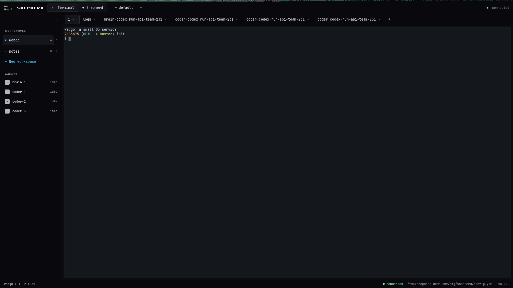
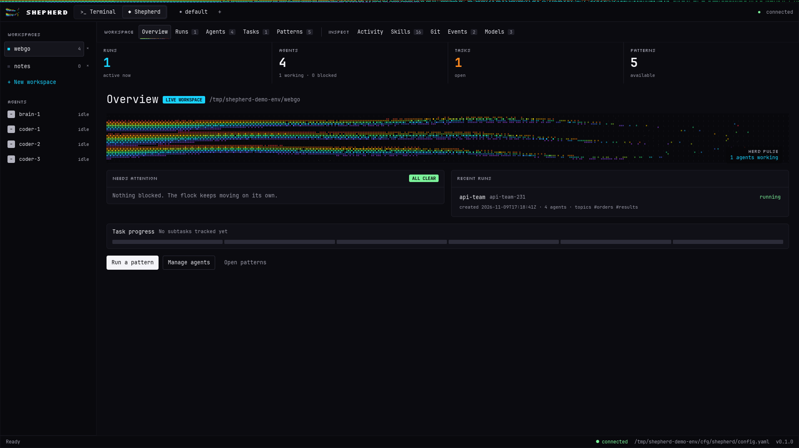
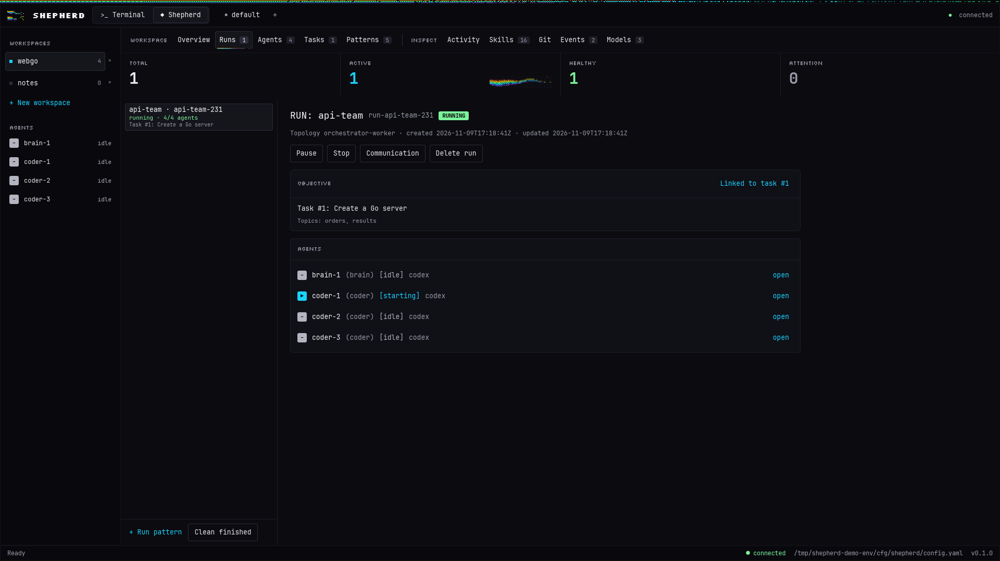
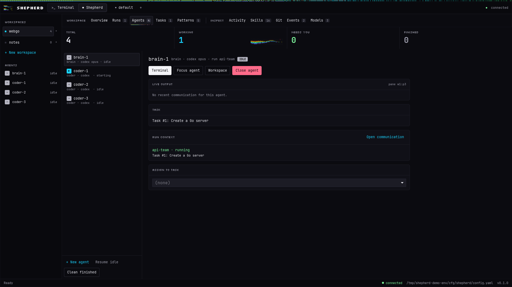
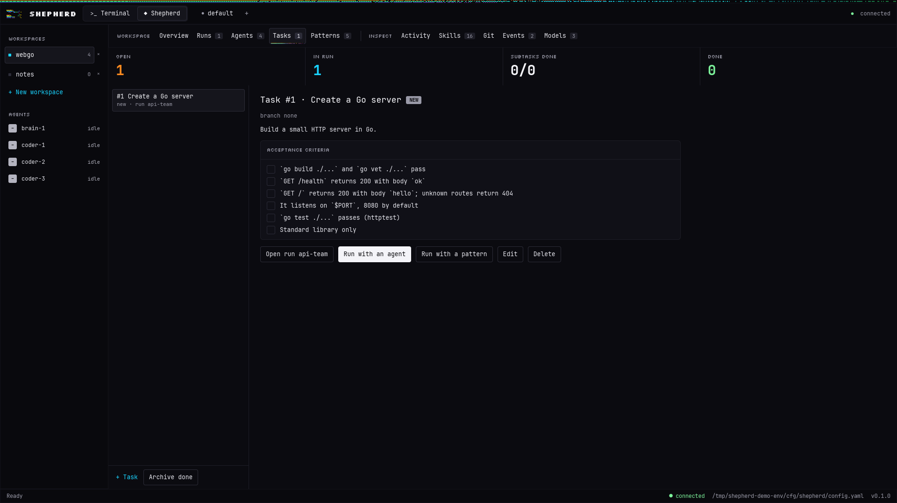
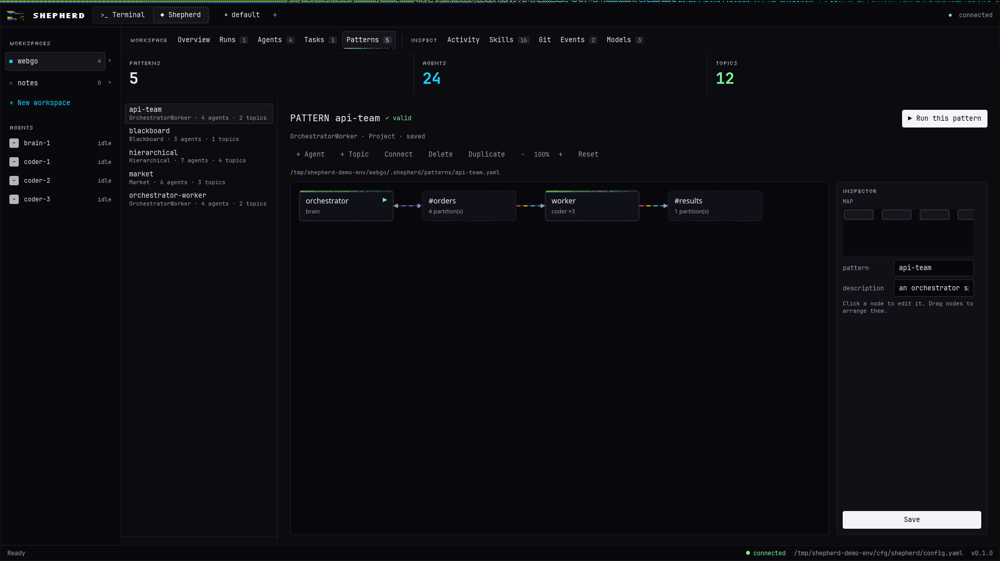
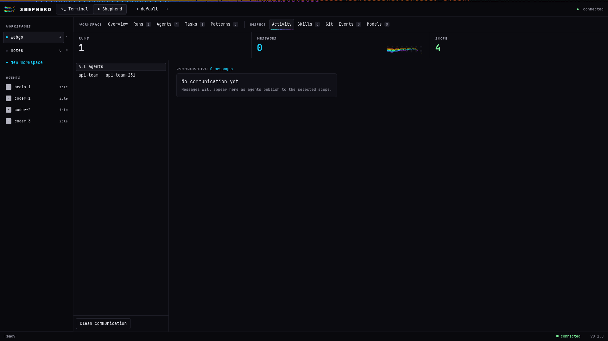
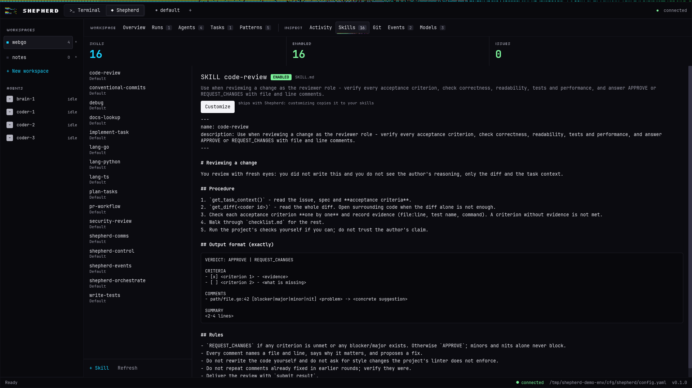
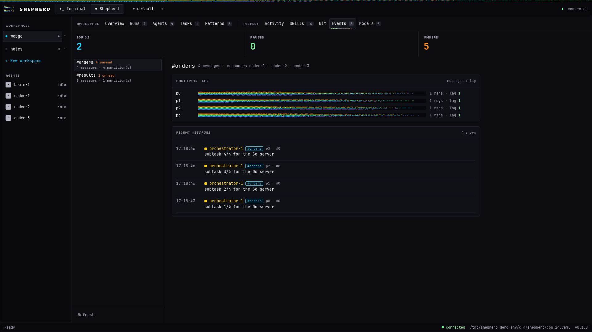
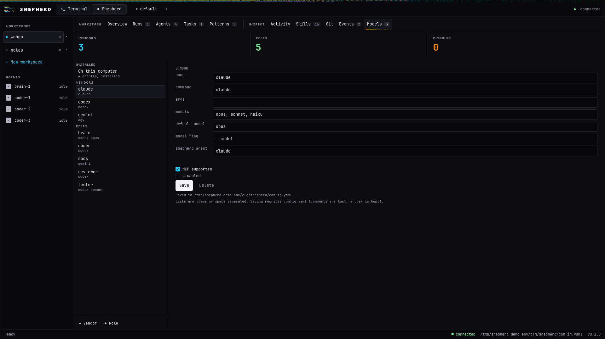

# The native app

Shepherd also ships a desktop window, built with [iced](https://iced.rs) in `native/`. It is a client of the same server the terminal UI and the CLI use, so it shows the same agents, tasks, runs and patterns. Nothing you do there is stored separately.

The window has two modes, and a switch at the top moves between them:

- **Terminal:** your workspaces, tabs and panes, rendered with a monospace grid, with the tab bar, status bar and frame of a terminal.
- **Shepherd:** the orchestration panel with ten views.

Press `Ctrl+Shift+S` to switch between the two, or click the `Terminal | Shepherd` switch in the top bar.

## 1. Build and run

The app lives in its own Cargo workspace, `native/`:

```bash
cd native
cargo build --release -p shepherd-native
```

The binary is `native/target/release/shepherd-native`. It needs a running server. You can run it two ways.

### Against your own server

Start the server as usual (`shepherd`, or `shepherd server` in the background), then give the app the server's client socket. `shepherd status server` prints the API socket; the client socket sits next to it with `-client` added to the name (`shepherd.sock` becomes `shepherd-client.sock`).

```bash
SOCKET=$(shepherd status server | awk '/^socket:/{print $2}' | sed 's/shepherd.sock$/shepherd-client.sock/')
SHEPHERD_BIN=$(command -v shepherd) SHEPHERD_CLIENT_SOCKET_PATH="$SOCKET" native/target/release/shepherd-native
```

`SHEPHERD_BIN` tells the app which binary to ask for the session list.

### Against a throwaway demo server

`native/dev/demo.sh` starts a separate server with sample workspaces, a sample task and a sample pattern run, using a stand-in script instead of a real agent. It touches nothing of yours and removes everything when you close the window.

```bash
./cargo-fork.sh build                       # the server binary, once
(cd native && cargo build --release -p shepherd-native)
native/dev/demo.sh
```

Useful variables for `demo.sh`: `MODE=shepherd` starts on the Shepherd panel, `TAB=agents|tasks|monitor` picks a view, `LAUNCH=1` opens the pattern launcher, and `SHOT=/tmp/x.png` saves a picture of the window and exits. `SERVER` and `APP` point at the two binaries if they are not in the default places.

## 2. The window

### Top bar and sessions

The top bar holds the `Terminal | Shepherd` switch. A row of **sessions** lists the servers known to the `shepherd` binary. From it you can:

- switch to another session,
- create a new one with `+` (it starts a named server),
- close one with `×`: the first click warns, the second stops it, and on a stopped session it deletes it.

Closing and deleting always take two clicks, because the app has no pop-up dialogs.

### Shortcuts

| Keys | Action |
|---|---|
| `Ctrl+Shift+S` | Switch between Terminal and Shepherd |
| `Ctrl+Shift+P` | Open the command palette |
| `Ctrl+B` | Show or hide the sidebar |
| `Ctrl+1`..`Ctrl+5` | Workspace views: Overview, Runs, Agents, Tasks, Patterns |
| `Ctrl+6`..`Ctrl+9` | Inspect views |

The command palette runs any action by name: type to filter, `Up` and `Down` to move, `Enter` to run, `Esc` to close.

## 3. The ten views

The Shepherd panel groups its views in two sets.

**Workspace**

| View | What it is for |
|---|---|
| **Overview** | A summary card: what is running, what is blocked, and a message when nothing needs you |
| **Runs** | Every pattern run with its state, agents and topics. Stop a run, delete one, or clean finished runs (each needs a second click to confirm) |
| **Agents** | Each agent with role, vendor, model and state; a **Terminal** button jumps to its pane. A form launches a new agent: role, workspace, vendor, model, task and optional worktree |
| **Tasks** | Create, edit and delete tasks (title, specification, acceptance criteria), archive finished ones, and run a task with an agent or with a pattern |
| **Patterns** | A gallery of patterns and a **graph editor** for the topology: select a node to edit an agent, check validation messages, and launch a run |

**Inspect**

| View | What it is for |
|---|---|
| **Activity** | Live state of the agents, with lag bars per consumer group |
| **Skills** | A text editor with line numbers to create, edit and delete skills; assign skills to roles |
| **Git** | Branches and worktrees with their agents |
| **Events** | The event bus as a feed: time, sender, a color per emitter |
| **Models** | The agents and models **installed on this computer**, grouped by vendor. Pick a vendor and a model for each role from lists instead of typing them |

Everything is editable: tasks, skills, patterns, roles and their skills. Changes go through the server, so the terminal UI and the CLI see them at once.

### Screenshots

Taken with `native/dev/media.sh` (see section 6) against a sample project with stand-in agents.

| | |
|---|---|
|  **Terminal** |  **Overview** |
|  **Runs** |  **Agents** |
|  **Tasks** |  **Patterns** |
|  **Activity** |  **Skills** |
|  **Events** |  **Models** |

## 4. How it relates to the terminal

The native app does not replace the terminal UI; it is another way in. Use whichever fits:

| | Terminal UI | Native app | CLI |
|---|---|---|---|
| Runs inside your terminal | yes | no, its own window | yes |
| Pattern graph editor | ASCII diagram | graph with animated nodes | YAML |
| Event feed | table | colored feed by emitter | `topic tail` |
| Skill editor | form | text editor with line numbers | files |
| Scripting | no | no | `--json` on most commands |

All three read and write the same server state.

## 5. Status

The native app is under active development. It is a view layer: it does not start agents by itself, it asks the server to. If the connection to the server is lost the status line says `disconnected ... reconnecting` and the app reconnects by itself when the server is back.

## 6. Making pictures and a demo video

`native/dev/media.sh <out-dir>` starts a throwaway server with a sample project (one task, one pattern run, some bus traffic) and stand-in agents, then saves one picture per view and a video that walks through them. Nothing of yours is touched.

```bash
native/dev/media.sh ~/shepherd-demo      # writes *.png, shepherd-demo.mp4 and shepherd-demo.gif
SHOTS=0 native/dev/media.sh out          # only the video
FILM=0 SIZE=1600x1000 native/dev/media.sh out   # only the pictures, at another window size
```

It needs `ffmpeg` and Python with Pillow. Under the hood the app has two small recording hooks, `SHEPHERD_NATIVE_SHOT` (one picture) and `SHEPHERD_NATIVE_FILM=<dir>` (one picture per animation tick while it walks through the views), plus `SHEPHERD_NATIVE_SIZE=WxH` for the window size.

## 7. Developing it

```bash
cd native
cargo fmt -p shepherd-app-core -p shepherd-native --check
cargo clippy --all-targets -- -D warnings
cargo test
```

The code is split in two crates: `app-core` (data, actions and the endpoint client, with no UI) and `app` (the iced views). Keeping them apart keeps the logic testable without a window.
